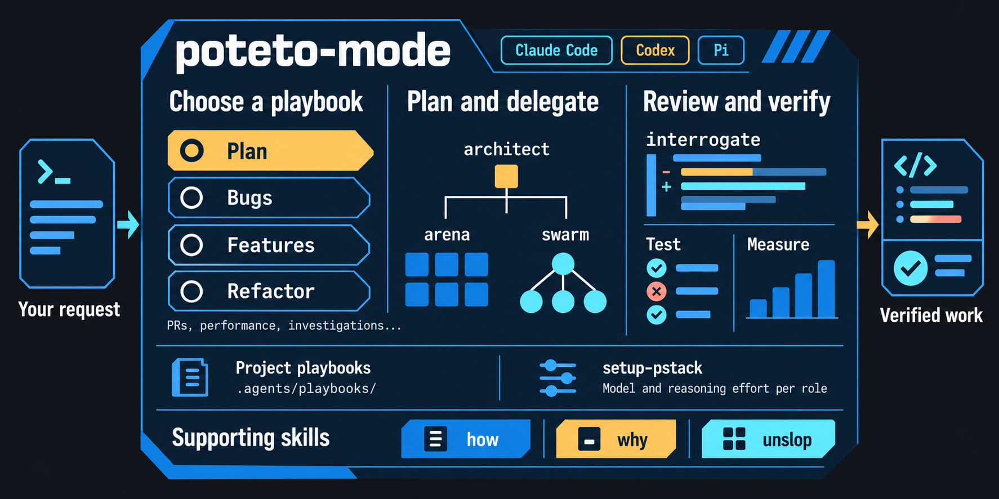

# pstack

[pstack](https://github.com/cursor/plugins/tree/main/pstack) is an opinionated skill stack created by Lauren Tan (poteto). This fork of Michael Denyer's port targets Oh My Pi (OMP) exclusively, with native GPT and DeepSeek model-role examples.

Tell `poteto-mode` your goal and it will invoke the correct workflow for the task. This package is for developing your own projects. Skills select commands, verification drivers, and diagnostic tools from the target repository and platform, whether you are working on a web app, native/mobile app, CLI, service, library, or development tool.

For concurrency bugs and invariants that tests cannot reach, use [create-formal-verification-skill](skills/create-formal-verification-skill/SKILL.md), then [maintain-formal-verification-skill](skills/maintain-formal-verification-skill/SKILL.md) as the code changes. The bundled [statechart](skills/statechart/SKILL.md) checks TLA+ models and draws state transitions and violation paths.

## Installation

### OMP package install

To install pstack into OMP, run in your terminal:

```shell
omp install github:arasan01/pstack
```

For a local checkout or development clone:

```shell
cd pstack
omp install .
```

To load the extension for a single session without installing:

```shell
omp -e .
```

### Usage

Start an omp session and request the skill you need by name, such as `poteto-mode`, `sharpen`, `architect`, `interrogate`, or `statechart`.

pstack integrates cleanly with native OMP execution:
- **Native lifecycle and roles**: Native `modelRoles`, `task.agentModelOverrides`, permissions, delegation, reasoning, fallback, and session lifecycle remain authoritative.
- **No foreign wrappers**: pstack does not require wrapper agents, subprocess runtimes, or replacement task tools.
- **Readonly root setup**: `setup-pstack` provides readonly guidance and diagnostics for native model roles and verification readiness; it never mutates global or user settings unless you explicitly choose to persist configuration.

## Getting started

```text
Use poteto-mode to fix the search filter resetting when I change pages.
```

For a bug, it reproduces the failure, investigates the cause, chooses design or delegation work when warranted, and reruns the failing case. Investigation-only and planning-only requests stop at their requested deliverable; they do not automatically become implementation or PR work.

[Other playbooks](skills/poteto-mode/SKILL.md#playbooks) cover planning, features, refactoring, performance issues, investigations, prototypes, PR maintenance, shipping, and longer projects.



## Details

- [Skills and slash commands](docs/reference.md#slash-commands)
- [Model guidance and configuration](docs/models.md)
- [Verification procedures](docs/verification.md)
- [Runtime reference](docs/reference.md)

## Data handling

pstack has no server or telemetry. Anything its skills ask your agent to read goes directly to your configured model provider. Scripts run locally, and PR tools use your local GitHub CLI login.

## Contributing

Bug reports, documentation fixes, and skill improvements are welcome. See [CONTRIBUTING.md](CONTRIBUTING.md) for the development checks and workflows. Report vulnerabilities privately as described in [SECURITY.md](SECURITY.md).

## License

This package and its modifications are [MIT-licensed](LICENSE), © 2026 Michael Denyer. Original pstack © 2026 Lauren Tan; imported cursor-team-kit skills © 2026 Cursor. Japanese prose rules from stop-ai-slop-jp are © 2026 Daichi Nagashima under [MIT](LICENSE-stop-ai-slop-jp). See [LICENSE-cursor-team-kit](LICENSE-cursor-team-kit) and [NOTICE.md](NOTICE.md).
